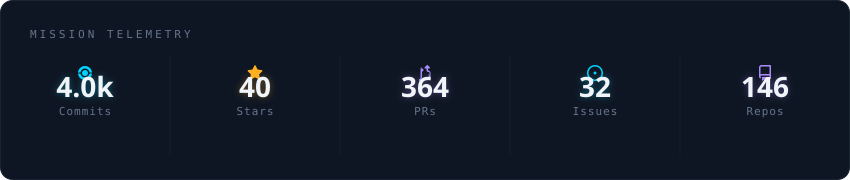

# Hi, I'm Blair Khan 👋

Building innovative solutions with code — I create scalable apps and systems across web and mobile.

- 🌍 Kampala, Uganda
- 🏫 Mountains of the Moon University
- 🔗 Portfolio: https://khanblair.github.io/portfolio/

## GitHub Streak

[](https://git.io/streak-stats)

## 🌌 Galaxy Profile

<div align="center">
  
</div>

<br/>

<div align="center">
  
</div>

<br/>

<div align="center">
  
</div>

<br/>

<div align="center">
  
</div>

<sub>Auto-generated every 12h by <a href="https://github.com/vinimlo/galaxy-profile">galaxy-profile</a> (GPL-3.0), configured in <a href="./config.yml">config.yml</a>.</sub>

## ⏱️ WakaTime Coding Activity

<!--START_SECTION:waka-->


**🐱 My GitHub Data** 

> 📦 1.7 MB Used in GitHub's Storage 
 > 
> 🏆 3,552 Contributions in the Year 2026
 > 
> 💼 Opted to Hire
 > 
> 📜 115 Public Repositories 
 > 
> 🔑 29 Private Repositories 
 > 
**I'm an Early 🐤** 

```text
🌞 Morning                3987 commits        ████░░░░░░░░░░░░░░░░░░░░░   17.46 % 
🌆 Daytime                12245 commits       █████████████░░░░░░░░░░░░   53.62 % 
🌃 Evening                5591 commits        ██████░░░░░░░░░░░░░░░░░░░   24.48 % 
🌙 Night                  1014 commits        █░░░░░░░░░░░░░░░░░░░░░░░░   04.44 % 
```
📅 **I'm Most Productive on Monday** 

```text
Monday                   5633 commits        ██████░░░░░░░░░░░░░░░░░░░   24.67 % 
Tuesday                  2904 commits        ███░░░░░░░░░░░░░░░░░░░░░░   12.72 % 
Wednesday                4171 commits        █████░░░░░░░░░░░░░░░░░░░░   18.26 % 
Thursday                 3053 commits        ███░░░░░░░░░░░░░░░░░░░░░░   13.37 % 
Friday                   4342 commits        █████░░░░░░░░░░░░░░░░░░░░   19.01 % 
Saturday                 1608 commits        ██░░░░░░░░░░░░░░░░░░░░░░░   07.04 % 
Sunday                   1126 commits        █░░░░░░░░░░░░░░░░░░░░░░░░   04.93 % 
```


📊 **This Week I Spent My Time On** 

```text
🕑︎ Time Zone: Africa/Kampala

💬 Programming Languages: 
TypeScript               21 hrs 31 mins      █████████░░░░░░░░░░░░░░░░   37.09 % 
Other                    16 hrs 38 mins      ███████░░░░░░░░░░░░░░░░░░   28.69 % 
Markdown                 9 hrs 28 mins       ████░░░░░░░░░░░░░░░░░░░░░   16.34 % 
JavaScript               3 hrs 31 mins       ██░░░░░░░░░░░░░░░░░░░░░░░   06.08 % 
Bash                     2 hrs 27 mins       █░░░░░░░░░░░░░░░░░░░░░░░░   04.23 % 

🔥 Editors: 
Claude Code              36 hrs 9 mins       ████████████████░░░░░░░░░   62.31 % 
Chrome                   17 hrs 14 mins      ███████░░░░░░░░░░░░░░░░░░   29.72 % 
VS Code                  1 hr 58 mins        █░░░░░░░░░░░░░░░░░░░░░░░░   03.40 % 
Terminal                 1 hr 22 mins        █░░░░░░░░░░░░░░░░░░░░░░░░   02.37 % 
Discord                  54 mins             ░░░░░░░░░░░░░░░░░░░░░░░░░   01.56 % 

🐱‍💻 Projects: 
pouch                    12 hrs 55 mins      ██████░░░░░░░░░░░░░░░░░░░   22.28 % 
reelcast                 9 hrs 45 mins       ████░░░░░░░░░░░░░░░░░░░░░   16.83 % 
marshal                  8 hrs 8 mins        ████░░░░░░░░░░░░░░░░░░░░░   14.02 % 
soundwave                6 hrs 54 mins       ███░░░░░░░░░░░░░░░░░░░░░░   11.89 % 
NUNUFUND_ShopPOS         3 hrs 42 mins       ██░░░░░░░░░░░░░░░░░░░░░░░   06.39 % 

💻 Operating System: 
Mac                      58 hrs 1 min        █████████████████████████   100.00 % 
```

🤖 **AI Coding This Week** 

```text
⏱ AI Coding Time: 29 hrs 33 mins (50.94%)

✍️ 31,076 lines written by AI, 305 lines written by hand (99.03% AI-written)

🔤 32,234,977 Input Tokens, 7,240,752 Output Tokens

💵 $738.51 Estimated AI Cost This Week

🧠 38 AI Sessions, 348 AI Prompts

Sonnet                   31,900 lines        █████████████████████████   99.92 % 
Opus                     24 lines            ░░░░░░░░░░░░░░░░░░░░░░░░░   00.08 % 

🔎 AI Coding Insights:
🤖 AI-Driven — 99.03% of written lines came from AI
📚 Verbose Prompter — average 2,106 characters per prompt
🔁 Iterative Prompter — average 9 prompts per session
🚀 High AI Trust — 1.08% of changed lines were hand-edited
```

**I Mostly Code in TypeScript** 

```text
TypeScript               53 repos            ██████████░░░░░░░░░░░░░░░   39.85 % 
Python                   17 repos            ███░░░░░░░░░░░░░░░░░░░░░░   12.78 % 
HTML                     16 repos            ███░░░░░░░░░░░░░░░░░░░░░░   12.03 % 
Go                       1 repo              ░░░░░░░░░░░░░░░░░░░░░░░░░   00.75 % 
Swift                    1 repo              ░░░░░░░░░░░░░░░░░░░░░░░░░   00.75 % 
```


**Timeline**


 Last Updated on 12/10/2026 05:27:21 UTC
<!--END_SECTION:waka-->

## 📈 Extra WakaTime Insights

<!--START_SECTION:waka-extra-->


🗂️ **My Coding Categories (Last 7 Days)** 

```text
AI Coding                29 hrs 33 mins       █████████████░░░░░░░░░░░░   50.94 % 
Coding                   11 hrs 20 mins       █████░░░░░░░░░░░░░░░░░░░░   19.56 % 
Browsing                 10 hrs 43 mins       █████░░░░░░░░░░░░░░░░░░░░   18.47 % 
Code Reviewing           6 hrs 1 min          ███░░░░░░░░░░░░░░░░░░░░░░   10.39 % 
Writing Docs             19 mins              ░░░░░░░░░░░░░░░░░░░░░░░░░   00.57 % 
Writing Tests            2 mins               ░░░░░░░░░░░░░░░░░░░░░░░░░   00.07 % 
```

📚 **Libraries & Dependencies (Last 7 Days)** 

```text
react                    3 hrs 19 mins        █░░░░░░░░░░░░░░░░░░░░░░░░   04.09 % 
test                     2 hrs 27 mins        █░░░░░░░░░░░░░░░░░░░░░░░░   03.01 % 
context                  1 hr 30 mins         ░░░░░░░░░░░░░░░░░░░░░░░░░   01.85 % 
lucide-react             1 hr 29 mins         ░░░░░░░░░░░░░░░░░░░░░░░░░   01.83 % 
client                   1 hr 27 mins         ░░░░░░░░░░░░░░░░░░░░░░░░░   01.79 % 
time                     1 hr 18 mins         ░░░░░░░░░░░░░░░░░░░░░░░░░   01.61 % 
github.com/khanblair/mar 1 hr 15 mins         ░░░░░░░░░░░░░░░░░░░░░░░░░   01.56 % 
strings                  1 hr 13 mins         ░░░░░░░░░░░░░░░░░░░░░░░░░   01.50 % 
```

💻 **Machines (Last 7 Days)** 

```text
Kolaborates-MacBook-Air. 58 hrs 1 min         █████████████████████████   100.00 % 
```

<!--END_SECTION:waka-extra-->
