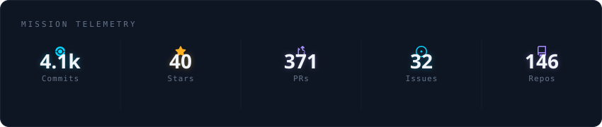
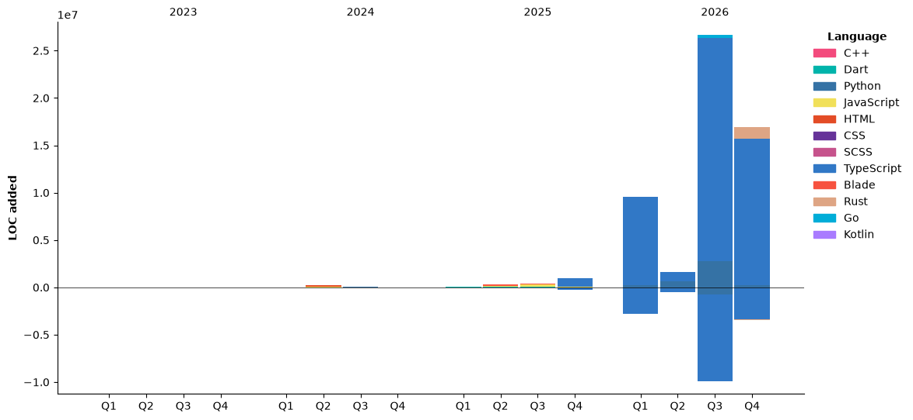

# Hi, I'm Blair Khan 👋

Building innovative solutions with code — I create scalable apps and systems across web and mobile.

- 🌍 Kampala, Uganda
- 🏫 Mountains of the Moon University
- 🔗 Portfolio: https://khanblair.github.io/portfolio/

## GitHub Streak

[](https://git.io/streak-stats)

## 🌌 Galaxy Profile

<div align="center">
  
</div>

<br/>

<div align="center">
  
</div>

<br/>

<div align="center">
  
</div>

<br/>

<div align="center">
  
</div>

<sub>Auto-generated every 12h by <a href="https://github.com/vinimlo/galaxy-profile">galaxy-profile</a> (GPL-3.0), configured in <a href="./config.yml">config.yml</a>.</sub>

## ⏱️ WakaTime Coding Activity

<!--START_SECTION:waka-->


**🐱 My GitHub Data** 

> 📦 1.7 MB Used in GitHub's Storage 
 > 
> 🏆 4,257 Contributions in the Year 2026
 > 
> 💼 Opted to Hire
 > 
> 📜 113 Public Repositories 
 > 
> 🔑 32 Private Repositories 
 > 
**I'm an Early 🐤** 

```text
🌞 Morning                7377 commits        ████░░░░░░░░░░░░░░░░░░░░░   15.49 % 
🌆 Daytime                24871 commits       █████████████░░░░░░░░░░░░   52.22 % 
🌃 Evening                12884 commits       ███████░░░░░░░░░░░░░░░░░░   27.05 % 
🌙 Night                  2499 commits        █░░░░░░░░░░░░░░░░░░░░░░░░   05.25 % 
```
📅 **I'm Most Productive on Monday** 

```text
Monday                   12548 commits       ███████░░░░░░░░░░░░░░░░░░   26.34 % 
Tuesday                  5596 commits        ███░░░░░░░░░░░░░░░░░░░░░░   11.75 % 
Wednesday                9646 commits        █████░░░░░░░░░░░░░░░░░░░░   20.25 % 
Thursday                 7554 commits        ████░░░░░░░░░░░░░░░░░░░░░   15.86 % 
Friday                   8169 commits        ████░░░░░░░░░░░░░░░░░░░░░   17.15 % 
Saturday                 2247 commits        █░░░░░░░░░░░░░░░░░░░░░░░░   04.72 % 
Sunday                   1871 commits        █░░░░░░░░░░░░░░░░░░░░░░░░   03.93 % 
```


📊 **This Week I Spent My Time On** 

```text
🕑︎ Time Zone: Africa/Kampala

💬 Programming Languages: 
Markdown                 13 hrs 38 mins      ██████░░░░░░░░░░░░░░░░░░░   23.17 % 
TypeScript               13 hrs 30 mins      ██████░░░░░░░░░░░░░░░░░░░   22.94 % 
Rust                     12 hrs 3 mins       █████░░░░░░░░░░░░░░░░░░░░   20.48 % 
Other                    9 hrs 37 mins       ████░░░░░░░░░░░░░░░░░░░░░   16.36 % 
JSON                     4 hrs 10 mins       ██░░░░░░░░░░░░░░░░░░░░░░░   07.09 % 

🔥 Editors: 
Claude Code              40 hrs 51 mins      █████████████████░░░░░░░░   69.41 % 
Chrome                   13 hrs 25 mins      ██████░░░░░░░░░░░░░░░░░░░   22.80 % 
Opencode Cli             1 hr 47 mins        █░░░░░░░░░░░░░░░░░░░░░░░░   03.04 % 
VS Code                  1 hr 15 mins        █░░░░░░░░░░░░░░░░░░░░░░░░   02.15 % 
Discord                  52 mins             ░░░░░░░░░░░░░░░░░░░░░░░░░   01.50 % 

🐱‍💻 Projects: 
sentinel-harness         19 hrs 58 mins      ████████░░░░░░░░░░░░░░░░░   33.93 % 
kolaborate-monorepo      14 hrs 7 mins       ██████░░░░░░░░░░░░░░░░░░░   24.00 % 
soundwave                11 hrs 42 mins      █████░░░░░░░░░░░░░░░░░░░░   19.90 % 
prismx-monorepo          4 hrs 12 mins       ██░░░░░░░░░░░░░░░░░░░░░░░   07.14 % 
goose                    2 hrs 48 mins       █░░░░░░░░░░░░░░░░░░░░░░░░   04.76 % 

💻 Operating System: 
Mac                      58 hrs 51 mins      █████████████████████████   100.00 % 
```

🤖 **AI Coding This Week** 

```text
⏱ AI Coding Time: 38 hrs 5 mins (64.72%)

✍️ 93,594 lines written by AI, 91 lines written by hand (99.9% AI-written)

🔤 57,104,683 Input Tokens, 12,964,339 Output Tokens

💵 $1336.89 Estimated AI Cost This Week

🧠 405 AI Sessions, 654 AI Prompts

Haiku                    57,336 lines        ██████████████░░░░░░░░░░░   57.53 % 
Sonnet                   20,796 lines        █████░░░░░░░░░░░░░░░░░░░░   20.86 % 
DeepSeek                 8,549 lines         ██░░░░░░░░░░░░░░░░░░░░░░░   08.58 % 
Nemotron                 7,731 lines         ██░░░░░░░░░░░░░░░░░░░░░░░   07.76 % 
GLM                      3,399 lines         █░░░░░░░░░░░░░░░░░░░░░░░░   03.41 % 

🔎 AI Coding Insights:
🤖 AI-Driven — 99.9% of written lines came from AI
📚 Verbose Prompter — average 3,654 characters per prompt
🔁 Iterative Prompter — average 2 prompts per session
🚀 High AI Trust — 0.1% of changed lines were hand-edited
```

**I Mostly Code in TypeScript** 

```text
TypeScript               53 repos            ██████████░░░░░░░░░░░░░░░   39.55 % 
HTML                     16 repos            ███░░░░░░░░░░░░░░░░░░░░░░   11.94 % 
Rust                     4 repos             █░░░░░░░░░░░░░░░░░░░░░░░░   02.99 % 
Go                       1 repo              ░░░░░░░░░░░░░░░░░░░░░░░░░   00.75 % 
Swift                    1 repo              ░░░░░░░░░░░░░░░░░░░░░░░░░   00.75 % 
```


**Timeline**




 Last Updated on 31/10/2026 05:09:20 UTC
<!--END_SECTION:waka-->

## 📈 Extra WakaTime Insights

<!--START_SECTION:waka-extra-->


🗂️ **My Coding Categories (Last 7 Days)** 

```text
AI Coding                35 hrs 53 mins       ████████████████░░░░░░░░░   63.08 % 
Browsing                 10 hrs 50 mins       █████░░░░░░░░░░░░░░░░░░░░   19.04 % 
Coding                   7 hrs 54 mins        ███░░░░░░░░░░░░░░░░░░░░░░   13.89 % 
Code Reviewing           1 hr 52 mins         █░░░░░░░░░░░░░░░░░░░░░░░░   03.29 % 
Writing Docs             21 mins              ░░░░░░░░░░░░░░░░░░░░░░░░░   00.64 % 
Writing Tests            1 min                ░░░░░░░░░░░░░░░░░░░░░░░░░   00.05 % 
```

📚 **Libraries & Dependencies (Last 7 Days)** 

```text
react                    6 hrs 57 mins        █░░░░░░░░░░░░░░░░░░░░░░░░   04.81 % 
react-native             3 hrs 10 mins        █░░░░░░░░░░░░░░░░░░░░░░░░   02.19 % 
expo-router              2 hrs 43 mins        ░░░░░░░░░░░░░░░░░░░░░░░░░   01.88 % 
ThemeProvider            2 hrs 5 mins         ░░░░░░░░░░░░░░░░░░░░░░░░░   01.45 % 
Icon                     1 hr 58 mins         ░░░░░░░░░░░░░░░░░░░░░░░░░   01.36 % 
onboarding               1 hr 51 mins         ░░░░░░░░░░░░░░░░░░░░░░░░░   01.28 % 
react-native-safe-area-c 1 hr 49 mins         ░░░░░░░░░░░░░░░░░░░░░░░░░   01.26 % 
wizard                   1 hr 49 mins         ░░░░░░░░░░░░░░░░░░░░░░░░░   01.26 % 
```

💻 **Machines (Last 7 Days)** 

```text
Kolaborates-MacBook-Air. 56 hrs 20 mins       █████████████████████████   99.05 % 
Mac                      32 mins              ░░░░░░░░░░░░░░░░░░░░░░░░░   00.95 % 
```

<!--END_SECTION:waka-extra-->
